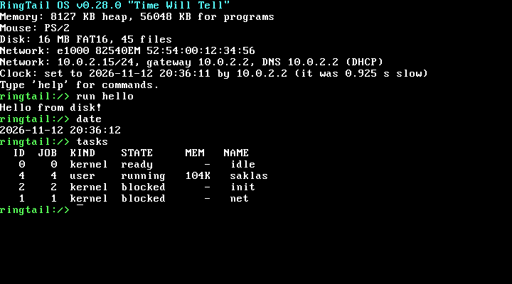

# RingTail OS

A small 32-bit x86 operating system written from scratch in freestanding
C and NASM. GRUB boots it through Multiboot. It runs ELF programs from a
FAT16 disk in separate, protected address spaces, and it has a preemptive
scheduler, a shell, a text editor, and a mouse-driven desktop in VGA mode
13h. It is on the network too: an Intel e1000 driver, ARP, IPv4, ICMP,
UDP and TCP, an address from DHCP, a DNS resolver, an SNTP client to
set the clock and a TLS 1.3 client, so `ping example.com` works and `fetch` gets a page over HTTP or HTTPS,
with the server's certificate checked against Mozilla's list of roots.
Current version: **v0.28.0 "Time Will Tell"**. See PROGRESS.md for the history.



A boot in QEMU, with the clock set by a time server; `run hello` is a program
read off the FAT16 disk.

## Building and running

You need nasm, grub-mkrescue (with xorriso), qemu-system-i386, python3
and a C compiler that can target i386. An `i686-elf-gcc` cross compiler
is used when one is installed. Otherwise the host gcc works with
`-m32`; on Debian and Ubuntu that means gcc-multilib.

```
make            # kernel, programs, disk image, bootable ISO, all in build/
make run        # boot it in QEMU; the serial console mirrors to this terminal
make run-serial # serial only, no window
make test       # host unit tests, then the QEMU integration suite
make clean
```

The disk image (`build/disk.img`) is ordinary FAT16. It holds the
programs in `src/programs` plus `WELCOME.TXT`, and files you write in the OS persist on it
across boots. Running `make` again rebuilds it from scratch, so copy it
somewhere else if you want to keep what you wrote. `mdir -i build/disk.img`
and `fsck.fat -n build/disk.img` both read it.

## Testing

`make test` runs the host tests, then the QEMU suite.

`tests/test_heap_diskfs.c` builds the real kernel heap and filesystem
code as a 32-bit Linux program, on top of a RAM disk that can be told to
fail writes. It covers allocation and coalescing, double frees and bad
pointers, name rules and long names (aliases, ~N tails, case,
slots across sectors and clusters, bad checksums), sparse writes, truncation, full disks, root
directory exhaustion, an I/O error during a replace (the old contents
must survive), subdirectories (paths, growth past one cluster, rmdir
rules, remounts, the depth limit), a non-default cluster size and
malformed volumes. At the
end, fsck.fat checks the image the run left behind.

`tests/test_netmsg.c` builds the DHCP, DNS and SNTP message code, the parts
that read bytes off the wire, under AddressSanitizer and UBSan. It
checks the DHCP client's messages byte by byte and the parser on offers,
NAKs, bad options and bad domains, then the DNS name rules, query
encoding and answer parsing: CNAME chains, compression (pointer loops,
forward pointers, names over 255 bytes), truncation, rcodes, and bytes
that must be escaped before a terminal sees them. For SNTP it checks
the request (nothing in it but a random nonce) and every reason to
ignore or refuse a reply (the wrong mode or nonce, a kiss-o'-death, a
server that is not synchronised, missing timestamps), which era a
timestamp belongs to on either side of the 2036 wrap, and the offset
and round trip from the four timestamps; and the calendar code the
clock is set through, every day from 1970 to 2105 both ways. All three
parsers then eat several hundred thousand mutated messages.

`tests/test_crypto.c` checks SHA-256, HMAC, HKDF, ChaCha20, Poly1305,
the two together, AES-128, AES-128-GCM and X25519 against the worked examples in the
documents that define them and against Project Wycheproof's vectors,
which are built to catch the mistakes implementations actually make
(a carry dropped in the last limb, a forged tag accepted, a public
value that gives a key of zeros).

`tests/test_tls.c` runs the TLS client against 218 recorded
conversations. `tests/gen_tls_cases.py` makes them: it plays a server
written separately from the client, straight from RFC 8446, that can do
everything a server may do (send its flight in one record or a byte per
record, pad, ask for a retry with a cookie, ask for a certificate,
update keys, send tickets) and most of what it must not (wrong version,
suite, group or key share, extensions missing, doubled or uninvited,
messages out of order, damaged records, a wrong Finished, about 150 in
all), each with the outcome and the alert the RFC asks for written down
beforehand. It also records real handshakes with OpenSSL, through
Python's `ssl` module and through `openssl s_server`, key updates
included. The test replays each one and checks the result and every
byte the client sent; delivers it again a byte at a time and in odd
pieces; and, for some, cuts it off at every length and flips a bit in
every byte, none of which may be accepted. The generator checks its own
key schedule against the worked example in RFC 8448.

`tests/test_sig.c` checks the signatures: SHA-384 and SHA-512 against
OpenSSL's answers, then RSA PKCS#1 v1.5, RSA-PSS and ECDSA on P-256 and
P-384 against 3303 cases from Project Wycheproof and OpenSSL, and every
signature that must verify is checked again with a byte of it, or of
the message, changed.

`tests/test_x509.c` checks certificates and path validation against
C2SP's x509-limbo, which collects the ways other verifiers have been
fooled (every server case but those about revocation, and a sample of
the BetterTLS name-constraint cases), plus 228 cases of our own made by
`tests/gen_x509_ours.py` from keys it derives itself, each with the
exact error it must give: dates to the second, wildcards, names,
malformed DER at every level, keys too weak, CAs that are not, path
lengths, loops, and name constraints of each kind. Where we answer
otherwise than limbo on purpose (28 cases, mostly the Web PKI's rules
where they differ from RFC 5280), the generator says why. A mutation
sweep (every early return in `x509.c` disabled in turn) found the
cases that were missing. It also reads every root in `disk/roots.pem`.

`tests/qemu_test.py` boots the real ISO in QEMU and drives the shell
over a serial socket. It uses `build/test-disk.img`, which adds the test
programs in `tests/programs` to the normal disk. It checks the boot
banner and runs every program, including the ones that are supposed to
crash. It covers bad pointers handed to syscalls, stack growth and
overflow, malloc, Ctrl+C on foreground jobs, background jobs, raw
terminal mode, ANSI output (read back from VGA memory through the QEMU
monitor), an editing session in Octavo, file and directory commands,
the timer rate,
the switch into graphics mode and back, reboot persistence and poweroff,
and the network through QEMU's user network: DHCP at boot, `ping`,
loopback, UDP and TCP sockets (`udptest`, `tcptest`), the random number
generator (`rndtest`), `fetch` and `nc`
against an HTTP server and an echo server on the host, `fetch` over TLS
against OpenSSL on the host with certificates the test makes (a
certificate from no trusted root refused by default, accepted with
--ca; an RSA-PSS server; a wrong name and an expired certificate
refused; -k; pages, redirects between http and https, chunked bodies,
a server that only speaks TLS 1.2, one that is not TLS at all, one that
hangs up; skipped when `openssl` or Python's `cryptography` is not
installed),
`net static` and
`net dhcp`, and `host` against `tests/dns_server.py`, a DNS server on the host whose
names each misbehave in their own way (aliases, loops, SERVFAIL, silence,
forged answers, truncation, a compression loop, escape codes in names),
and `sntp` against `tests/ntp_server.py`, a time server that answers
in whatever manner the test asks (an hour off, forged, kisses of death
with escape codes in them, unsynchronised, silent, late, slow, from
2001 or 2101): the clock is set an hour on and back, to within a tenth
of a second, and is left alone when it should be; `sntp -b` answers in
its one line, once, quickly; the kernel refuses
dates that do not exist and times before the build, and runs a leap
day into March. The boot's own sync asks pool.ntp.org, since QEMU's
DHCP names no time server, and passes however that ends. Afterwards it runs fsck.fat and mtools against the disk. Then it boots
again on a socket network whose only other host is `tests/net_peer.py`,
which puts raw Ethernet frames on the wire and plays the network's DHCP,
DNS and time server: the guest must set its clock at boot from the time
server DHCP names, without looking anything up. It checks the DHCP messages field by field and a lease's
whole life (renewing, rebinding, running out, NAKs, lying servers, an
address set by hand), ARP and pings of every size and shape, packets
that must be ignored (bad checksums, fragments, other addresses,
broadcasts, short headers), UDP echoed by a guest program and port
unreachable for closed ports, the search domain and a second DNS server,
the guest's own pings answered, timed out, refused by a router or
damaged, and 4000 frames of garbage. Short boots check the other two
e1000 models and a machine with no card. Pass `--keep` to keep the
serial log and the disk.

## Design in brief

Memory: the kernel identity-maps the first 1 GB for itself, supervisor
only, with its code and read-only data write-protected. Each program gets
the range from 1 GB to 3 GB. Its image is mapped from the ELF segments
with their real permissions. The stack sits at the top and grows on
demand up to 1 MB, with an unmapped guard gap below it. The kernel heap
and the physical frame pool are sized from the Multiboot memory map. A program's heap is the break above its image, moved with
`sbrk`; the C runtime has malloc, calloc, realloc and free on top.

Tasks: a round-robin, preemptive scheduler runs on the 100 Hz PIT. The
kernel's own tasks (idle, init) and user programs are scheduled the same
way. init gives DHCP its chance, runs `sntp -b` once if the network is
up, then starts SAKLAS from the disk, hands it the terminal, and starts a
fresh one whenever it ends. A program that faults is killed and the fault is
logged (`faults` in the shell). A kill takes effect at the next safe
point, never in the middle of a kernel operation. The tty belongs to one
foreground job, which receives keyboard input, Ctrl+C and Ctrl+\. A job
can lend the terminal to a job it started and take it back once that job
is gone, getting its own terminal mode back with it; that is how the
shell runs a program in the foreground. It lends it as part of the spawn
(`SPAWN_FOREGROUND`), so the program has the terminal before its first
instruction rather than racing its parent for it.

Terminal: programs read the keyboard (or the serial port) through
standard input, a line at a time by default. Raw mode hands over every
key as it comes, with arrows, Home/End, PgUp/PgDn, Delete and F1-F12 as
xterm escape sequences and Alt as an ESC prefix; with TTY_NOSIG, Ctrl+C
is an ordinary byte, and Ctrl+\ is the kill switch that always works. `poll`
waits up to a given number of ticks for input, so a program can redraw on a
timer and still answer a key at once. The console understands the common ANSI escapes for cursor
motion, erasing, colours and hiding the cursor, on screen and on serial
alike. Opening `/dev/tty` (`DEV_TTY`) gives the terminal itself, read-only for
keys or write-only for output, whatever standard input and output are
redirected to; that is how `more` can wait for a key at the end of a pipe.

System calls: `int 0x80`, with the number in eax, arguments in ebx, ecx
and edx, and the result in eax. A failed call returns a negative errno.
Every user pointer is checked against the caller's page tables before the
kernel touches it. The numbers and structures are in
`src/include/ringtail/abi.h`, and the user-side wrappers are in
`src/programs/lib/ulib.h`. A spawned program inherits copies of its
parent's standard input, output and error (descriptors 0-2), and spawn
can remap them or put the program in a new or existing job. The shell is
an ordinary program: everything it shows comes through syscalls such as
`readdir`, `kinfo` (version, memory, heap, tasks, faults, memory map,
disk) and `kill`. Pipes are 4 KB kernel buffers: a reader waits for data
and sees end of file once every writer has closed, and a writer waits
for room. `dup2` copies a descriptor onto another number.

Filesystem: FAT16 with subdirectories and Windows-style long names
(VFAT). A name is up to 255 printable ASCII characters, none of
`\ / : * ? " < > |`, not starting with a space or ending in a space or
dot. Case is kept as typed and ignored when matching, so `cat readme.TXT`
finds `ReadMe.txt`. A name that fits 8.3 in one case per part is stored
as a plain short entry (lowercase via the NT case bits, like Windows);
any other gets long-name slots and a short alias such as `MYDOCU~1`,
which also works as its name. Disks written by Windows, Linux or mtools
read the same way. Paths use `/`, start at the task's current directory
unless they begin with `/`, and know `.` and `..`; a directory's full
path is at most 255 characters. Each task has
its own current directory, inherited by the programs it starts. The FAT
and the root directory are kept in memory, subdirectory sectors go
through a small cache, and all of it is written back after each
operation, FAT first. Files and directories are stamped with the CMOS clock when they are made and
when their contents change (`ls` shows it, `date` prints the clock; a rename
keeps it). A new directory's cluster is zeroed on disk before
anything points at it.
File data is always written before the metadata that points at it.
Replacing a file builds the new contents in fresh clusters before
switching the directory entry, so a failure leaves the old file intact;
programs get that through the `save` syscall.
Rename moves the entry (and a directory's `..`), so an open file stays
open through it, and a directory cannot be moved inside itself. An open
file cannot be deleted, and a directory that is some task's
current directory cannot be removed.

Network: PCI devices are found by scanning configuration space at boot
(`pci` lists them). The e1000 driver maps the card's registers into a
4 MB device window at 0xC0000000, above user space and in every address
space but supervisor only, and runs a 32-buffer receive ring and an
8-buffer transmit ring. Its interrupt only wakes the `net` kernel task,
which takes frames off the ring and handles them under one lock, so the
stack never runs in interrupt context. ARP learns neighbours from requests aimed at us and asks three times, a
second apart, before giving up; IPv4 checks lengths and checksums and
drops fragments; ICMP answers echo requests (not broadcast ones) and
matches replies and routers' unreachable messages to the `ping` syscall
waiting for them. Round trips are timed in microseconds from the PIT's
counter. Anything sent to 127/8 or the machine's own address goes round
through the net task without touching the card.

UDP sockets are file descriptors (`socket`, `bind`, `sendto`,
`recvfrom`; `read` and `write` refuse them). Binding port 0 picks a
random free port from 49152 up, port 68 is the DHCP client's, each
socket queues 16 datagrams and drops the rest, and a datagram for a
closed port gets ICMP port unreachable unless it was a broadcast. The
DHCP client (RFC 2131) runs in the net task: DISCOVER at boot, renewing
at T1 straight to the server, rebinding at T2 by broadcast, starting over
when the lease runs out or on a NAK, which it answers more slowly each
time. It asks for, and keeps, the time servers (option 42) as well as
the DNS ones. init gives it five seconds before starting the shell. `net static`
turns it off and sets the address by hand; `net dhcp` starts it again,
asking for the address DHCP gave last. The DNS resolver is user code
(`src/programs/lib/dns.c` over `dnsmsg.c`), linked into the programs
that look names up: it asks each server DHCP named in turn, twice, 2 s
each, from a random port with a random ID, believes an answer only from
that server's address and port with that ID and the same question,
follows up to 8 aliases, and tries a name with no dot under the search
domain first. Names that come back are escaped before they are printed.

TCP is split in two. `src/net/tcp.c` is the protocol engine and knows
nothing of the kernel: RFC 9293 with the MSS option (no window scaling,
timestamps or SACK), RFC 6298 retransmission timing, slow start and
congestion avoidance with NewReno fast recovery, zero-window probes,
delayed ACKs, out-of-order segments held until the gap fills, and the
RFC 5961 checks against blind resets and SYNs. Each connection buffers
16 KB each way; there are 64 at most, counting those still closing.
`tests/test_tcp.c` runs the engine on the host against a simulated
network that loses, reorders and duplicates segments.
`src/net/tcpsock.c` puts it in the kernel: the calls behind `connect`,
`listen`, `accept`, `shutdown` and the rest, all under the net lock,
with tasks sleeping on the connection and the wakeups sent once the
engine is done. TCP sockets read and write like files, and `pollfd`
waits on any mix of sockets, pipes and the terminal.

Random numbers come from the kernel (`src/kernel/random.c`, the `random`
syscall). Every interrupt stirs the CPU's cycle counter into a pool,
and RDRAND goes in where the CPU has it; each request hashes the pool
into a fresh ChaCha20 key, and the key is replaced before the answer is
handed out, so one answer says nothing of the next or the last. TCP
sequence numbers, ports, and DNS and DHCP ids come from it, and so do
TLS keys. Its weak moment is straight after boot on a CPU without
RDRAND, when there has been little to collect.

The clock is the CMOS chip's (`src/drivers/rtc.c`), read on every
`time` call. `settime` sets it to the second, holding the chip's
divider in reset while it writes, so that its next second starts half
a second after the call; a caller that wants it exact calls at the
half second. The kernel refuses a time before the last commit it was
built from (`RINGTAIL_TIME_FLOOR`, which the Makefile writes to
`build/gen/timefloor.h`), since a clock set before the code existed is
wrong, and since an expired certificate looks good again to a clock
wound back to when it was. `sntp` (`src/programs/net/sntp.c` over
`lib/ntpmsg.c`) is the client, RFC 4330 SNTP: it sends a version 4
request whose only content is a random transmit timestamp, believes
a reply only from the address and port it asked, in server mode,
echoing that timestamp, and refuses one from a server that is not
synchronised or sends a kiss-o'-death. Each try gets a fresh nonce,
two tries of 2 s per address and four addresses at most. Its own
clock for the exchange is the CMOS second it waits to turn over plus
timer ticks since, so the offset is good to about 10 ms. A wire
timestamp is placed in the 136-year era nearest the machine's own
clock, so the 2036 wrap is handled and a clock reset to 2000 still
finds 2026. Without a server named, sntp asks the time servers DHCP
gave (`net` lists them as Time), or pool.ntp.org if there are none.
init runs `sntp -b` at boot, once the network has an address: one try
of a second at no more than two addresses, then one line, "Clock:",
saying what it set, or that it left the CMOS time and why, before the
shell starts.

TLS is user code (`src/programs/lib/tls.c`), a TLS 1.3 client
(RFC 8446) over any stream of bytes: it makes no system calls and
reaches the socket and the random numbers through three functions the
caller gives, which is how the host tests run the same code. It offers
two cipher suites, ChaCha20-Poly1305 first and AES-128-GCM (the one
every server must take), both with SHA-256, and one key exchange,
X25519. None of them looks anything up by a secret or branches on one,
so the time they take gives nothing away; for AES, whose usual form is
a table lookup, that means a bitsliced S-box, a circuit of 113 ANDs and
XORs run on two blocks at once (`src/programs/lib/aesgcm.c`). It is
about ten times slower than ChaCha20 here, which is why ChaCha20 is
asked for first. It sends the server name, answers a HelloRetryRequest
that brings a cookie, turns down a request for a client certificate,
follows key updates, ignores session tickets, and keeps to the record
limits; a server that breaks a rule gets the alert the RFC names and
the connection is over.

The certificate is checked by a verifier the caller hands to the TLS
code, so `tls.c` itself knows nothing of X.509. The one fetch uses is in
`src/programs/lib/x509.c`: it reads the certificates (strict DER, version
3 only, an unknown critical extension refused), searches for a path from
the server's certificate through any it sent to a trusted root, and
checks every signature on it, the dates of each certificate against the
clock, that each CA is one (basicConstraints), its path length, key
usage and extended key usage, and name constraints on DNS names, IP
addresses and directory names. The name is matched against the
subjectAltName only, never the common name, with a wildcard standing
for exactly one leftmost label. Then the server's own signature over
the handshake is checked with the key in its certificate. The
signatures are `src/programs/lib/sig.c`: RSA (PKCS#1 v1.5 and PSS, 2048
to 4096 bits) and ECDSA on P-256 and P-384, over a small Montgomery
big-number library; SHA-1 and RSA keys under 2048 bits are refused. The
roots are Mozilla's, as the ca-certificates package ships them, in
`/roots.pem` on the disk (`tools/mkroots.py` makes `disk/roots.pem`).

## Source layout

```
src/boot       Multiboot header, entry, kernel linker script
src/kernel     kernel_main, GDT/IDT/interrupts, tasks, syscalls, ELF loader, faults, power, random numbers
src/mm         heap, physical frames, paging and checked user copies
src/drivers    console (VGA text + serial), tty, keyboard, mouse, timer, ATA, VGA graphics, PCI, e1000
src/net        ARP, IPv4, ICMP and loopback (net.c), UDP sockets (udp.c), TCP (tcp.c, tcpsock.c), the DHCP client (dhcp.c, dhcpmsg.c)
src/fs         FAT16 (diskfs.c) and file descriptors (file.c)
src/lib        string and printf subset, SHA-256, ChaCha20 and calendar dates, shared by the kernel and programs
src/include    kernel headers; ringtail/abi.h is the user/kernel contract
src/programs   user programs in folders, their C library (lib/: runtime, malloc, DNS, SNTP, TLS) and linker script
  apps         the big interactive programs: saklas (the shell), kenoma, octavo, gauge
  files        files and directories as things: ls, cp, mv, rm, mkdir, rmdir, touch, find, du, df, basename, dirname
  text         what is inside files and pipes: cat, grep, sed, sort, diff, od and the rest of the filters
  net          talks to the network: ping, host, nc, fetch, httpd, sntp
  util         small tools for building command lines: echo, seq, sleep, xargs, cal, hello and the like
tools          mkdisk.py, the FAT16 image builder
tests          host unit tests, the QEMU integration suite, test programs
```

## Using it

Type `help` at the `ringtail:/>` prompt (it shows the current directory) for the command list. The editor
keeps the last 10 lines (Up and Down). Left, Right, Home, End, Delete and
Backspace work anywhere in the line, Ctrl+Left/Right (or Alt+B/F) jump a
word, and Ctrl+A/E/B/F do what Home/End/Left/Right do. Ctrl+W deletes the word before the cursor, Ctrl+K the rest of
the line and Ctrl+U the whole line. Ctrl+C cancels a line or kills the
foreground program, and Ctrl+L clears the screen. Tab (which works on the end of the line) completes commands,
programs and paths, ignoring case and quoting names with spaces; a second
Tab with several matches lists them.

`run <program> [args...]`, or just the program's name, starts a program
from the disk, and a trailing `&` runs it in the background.
`a | b` pipes one program's output into the next, `< FILE` feeds the
first command a file, and `> FILE` or `>> FILE` writes or appends the
last command's output. A built-in can start a pipeline (`help | grep file`)
or be redirected (`help > h.txt`), but not come after a `|` or take `<`.
Ctrl+C stops every program in a pipeline. `tasks` lists what is running and
`kill <id>` stops it. The file commands (`ls`, `cat`, `echo`, `touch`, `rm`,
`mkdir`, `rmdir`, `mv`, `cp`) are programs on the disk like any other, so they
pipe, take `<`, and run under `find -exec`; `cat a b > c` joins files, `rm -r`, `cp -r`, `mkdir -p` and `ls -R` work on
trees, and quote text for `echo` to keep its spacing. An unquoted word with `*`, `?` or `[a-z]` / `[!x]` in it is a wildcard: it is replaced by the matching names, sorted and ignoring case, one directory level per `/` (`ls *.txt`, `cat d/*.c`, `*/readme`); names starting with a dot match only a pattern that starts with a dot, a pattern that matches nothing stays as typed, and quoting a word turns the wildcards off. `write <file> <text>` stays a built-in, and `cd` and `pwd` work on the current directory. Every file argument can be a path (`docs/a.txt`, `"My Docs/notes.txt"`,
`../B.TXT`, `/WELCOME.TXT`). A bare program name is always looked up in
`/`, wherever you are; give a path to run one from somewhere else. `mem`, `heap` and `mmap` show memory, `date` the clock, `uptime` the
time since boot and timer ticks, and `faults` the fault log. `pci` lists the PCI devices, and `net` shows
the network card, the address and where it came from, the DNS servers,
traffic counts, UDP sockets and the ARP table. `net static
10.0.2.20/24 10.0.2.2 10.0.2.3` sets the address, gateway (or `none`) and
DNS server by hand, and `net dhcp` goes back to DHCP. `color <name>` sets
the text colour, and `reboot` and `poweroff` do what they say. `exit`
ends the shell, and init starts a new one.

Programs on the disk:

| Program | What it does |
|---|---|
| octavo | Text editor. `run octavo [file]`. |
| kenoma | Desktop: a paged launcher for every program, and page icons for .txt, .lemur and .lem files that open them in Octavo. Esc quits. |
| saklas | The command line (the shell). init starts it at boot and again whenever it ends. |
| gauge | System monitor: memory, disk and every task, redrawn each second. q quits, p pauses, + and - change the rate. `gauge -1` prints one plain snapshot, so it pipes. |
| ping | `ping [-c COUNT] [-s SIZE] [-W MS] HOST`: ICMP echo, a second apart, with round trips and a summary. HOST is an address or a name. |
| host | `host [-p PORT] NAME [SERVER]`: asks DNS about a name, or about an address for its name, and prints the answer the way BIND's `host` does. |
| sntp | `sntp [-q] [-b] [-p PORT] [SERVER]`: asks a time server (default: the ones DHCP named, else pool.ntp.org) how far off the clock is and sets it, unless it is right to within half a second; `-q` only asks, `-b` is quick and says it all in one line, as at boot. Refuses a time before the system was built. |
| fetch | `fetch [-i] [-k] [--ca FILE] [-o FILE] URL`: gets a page over HTTP/1.1, or over HTTPS when the URL starts with `https://`, following up to five redirects. -i shows the headers, -o saves the body. HTTPS checks the server's certificate against the roots in `/roots.pem`, or against the certificates in FILE with --ca; -k skips the check and says so each time. |
| httpd | `httpd [-p PORT] [-q] [DIR]`: serves DIR (default: the current directory) over HTTP on port 8080, one connection at a time. A directory gives its index.html or a listing; `..` is refused. Logs each request unless -q. Ctrl+C stops it. |
| nc | `nc [-C] [-v] [-w SECS] HOST PORT` or `nc -l PORT`: a TCP connection between the terminal (or stdin) and the other end. -C sends CR LF line ends. |
| sleep | `sleep <seconds>`, up to an hour. |
| ls | `ls [-R] [PATH...]`: lists files and directories with sizes and dates; a file is listed as itself, `-R` goes down. A free-space line on the terminal. |
| cat | `cat [-n] [FILE...]`: copies files, or its input (also `-`), to the output; `-n` numbers the lines. Bytes pass through exactly. |
| echo | `echo [-n] [-e \| -E] [TEXT...]`: prints its arguments, one space apart; `-e` reads `\n \t \xHH` and friends. |
| touch | `touch [-c] FILE...`: creates empty files; one that exists is left alone (it keeps its old date; there is no call to set one). |
| rm | `rm [-f] [-r] FILE...`: deletes files; `-r` takes whole directories, `-f` ignores missing ones. `.`, `..` and `/` are never removed. |
| mkdir | `mkdir [-p] DIR...`: makes directories; `-p` makes the parents too and accepts one that exists. |
| rmdir | `rmdir DIR...`: removes empty directories. |
| mv | `mv [-f \| -n] SRC DST` or `mv ... SRC... DIR`: renames or moves a file or a whole directory, replacing a file already there (`-n` keeps it). |
| cp | `cp [-r] [-f \| -n] SRC DST` or `cp ... SRC... DIR`: copies files, and with `-r` whole directories; replaces an existing file unless `-n`. |
| wc | `wc [-lwcmL] [files]`: lines, words, bytes (or just the ones asked for), and `-L` the longest line; a total for several files. |
| grep | `grep [options] PATTERN [files]`: the lines matching a basic regular expression (`-E` extended, `-F` plain text), with `-i -v -w -x -c -l -L -n -o -m -q -s -H -h -e -f -r -A -B -C`. Lines of any length, "Binary file X matches" for binary files. No back-references. |
| head | `head [-n N \| -c N] [-q] [FILE...]`: the first 10 lines of each file, or of its input; `-N` is `-n N`. Stops reading once it has enough. |
| tail | `tail [-n [+]N \| -c [+]N] [-q] [FILE...]`: the last 10 lines, or everything from line N on with `+N`. Reads to the end, keeping only what it needs. No -f. |
| sort | `sort [-bcfnrsu] [-k F1[,F2]] [-t SEP] [-o FILE] [FILE...]`: sorts lines bytewise, or as numbers with -n, backwards with -r, ignoring case with -f. -u drops repeats, -c only checks, -o may name an input. One -k key, with the usual field rules. Ties go by the whole line unless -s or -u. Holds all its input in memory. |
| uniq | `uniq [-c \| -d \| -u] [-i] [-f N] [-s N] [-w N] [INPUT [OUTPUT]]`: collapses runs of equal lines, with -c counts, -d only the repeated, -u only the single. Streams, so it works on any size; run `sort` first. |
| cut | `cut -b\|-c\|-f LIST [-d DELIM] [-s] [--complement] [--output-delimiter=STR] [FILE...]`: bytes or tab-separated (or `-d`) fields of each line, picked by a list like `1,3-5,8-`. A line with no delimiter passes through unless `-s`. |
| tr | `tr [-cCdst] SET1 [SET2]`: translates, deletes (`-d`) or squeezes (`-s`) bytes of standard input. Sets take ranges, `[:alpha:]`-style classes, `[c*N]` repeats and `\n \t \NNN` escapes; `-c` is the complement of SET1. |
| tac | `tac [-b] [-s SEP] [FILE...]`: each file with its records last first. `-b` puts the separator before its record, `-s` changes it from a newline (an empty string means a NUL byte). A last line with no newline is written first, joined to the one after it, as GNU does. Reads the whole file into memory; no `-r`. |
| rev | `rev [FILE...]`: each line back to front. Works on bytes, not characters, so a multi-byte UTF-8 letter comes out in pieces. A last line with no newline stays without one. |
| nl | `nl [-b\|-h\|-f STYLE] [-n ln\|rn\|rz] [-w N] [-s SEP] [-v N] [-i N] [-l N] [-d CC] [-p] [FILE...]`: numbers lines, counting on from file to file. Styles are `a` (all), `t` (non-empty, the default for the body), `n` (none) and `pREGEX` (basic syntax). Lines made of `\:\:\:`, `\:\:` and `\:` start a header, body and footer and restart the numbers unless `-p`. Numbers are 64 bits; running out is an error. |
| paste | `paste [-s] [-d LIST] [FILE...]`: the files side by side, line 1 of each joined by a tab, then line 2, and so on; a file that runs out gives empty fields. `-s` makes one line for each file instead. `-d` takes a list of delimiters used round and round (`\n \t \\` and `\0` for none are understood). Every `-` is the same standard input, so `paste - -` joins pairs of lines. Opens every file before it writes, so a missing one prints nothing. Bytes, not characters; no `-z`. |
| comm | `comm [-123] [--check-order \| --nocheck-order] [--output-delimiter=STR] [--total] FILE1 FILE2`: compares two sorted files into three columns: only in the first, only in the second, in both (`-1 -2 -3` leave one out). Without a check option it warns about a line out of order once the files have disagreed, as GNU does, and exits 1 at the end. `--total` adds the counts. Compares bytes, not locale order; no `-z`. |
| join | `join [-i] [-t C] [-1 N] [-2 N] [-j N] [-a 1\|2] [-v 1\|2] [-e STR] [-o LIST\|auto] [-z] [--check-order \| --nocheck-order] [--header] FILE1 FILE2`: puts together the lines of two sorted files that share a key, like looking things up in a table. Each pair of lines with the same join field (the first, unless `-1 -2 -j` say otherwise) becomes one line: the key, the rest of the line of FILE1, the rest of the line of FILE2. `-a N` also writes the lines of file N that found no partner, `-v N` writes only those, `-e STR` fills a missing or empty field, and `-o` picks the fields to write (`0` is the key, `1.2` is field 2 of file 1; `auto` takes as many as the first line has). Fields are split at runs of blanks, or at each `C` with `-t` (an empty `C` makes the whole line one field, `\0` is a NUL); `-z` makes the lines end in NUL; `--header` joins the first lines as headings. The files must be sorted bytewise on the key; as in GNU, a line out of order is reported once for each file (`join: FILE:LINE: is not sorted: ...`) when it matters, `--check-order` stops at it, and the end status is 1. Checked against GNU case by case, including the cross product of equal keys, the messages and how `-j1` is told from `-j 1`. A usage error is status 2, where GNU's is 1, `--version` stops with a message, and `-i` folds ASCII letters only. Names in messages are quoted as GNU does, except a name that mixes an apostrophe with control bytes. |
| expand | `expand [-i] [-t LIST] [FILE...]`: the files with each tab turned into spaces up to the next tab stop, which is every 8 columns unless `-t` says otherwise. `-t N` puts a stop every N columns; `-t 4,8,12` lists the stops, after which a tab is a single space; the last may start with `/` (then every multiple of it) or `+` (then every so many past the last). Another `-t` goes on from the one before. `-i` converts only the tabs before any other character on a line. A backspace goes back a column. The files are one stream, so a last line with no newline carries on into the next file. Columns count bytes, not characters: a UTF-8 letter is as many columns as it has bytes, and nothing is double-width. No `-4` for `-t 4`. |
| unexpand | `unexpand [-a \| --first-only] [-t LIST] [FILE...]`: the opposite: runs of spaces that end at a tab stop become a tab. Only the blanks at the start of a line unless `-a` (or `-t`, which implies it; `--first-only` wins over both). A single space is turned into a tab only when it follows another blank or starts the line, as in GNU. `-t` takes the same lists as `expand`; past the last stop of a list with no end, nothing is changed. One stream and byte columns, as for `expand`. |
| fold | `fold [-b] [-s] [-w WIDTH] [FILE...]`: every line cut so it is no more than WIDTH columns (80 by default; `-N` is `-w N`). A tab goes to the next multiple of 8, a backspace back a column and a carriage return to column 0; `-b` counts every byte as one column instead. `-s` cuts after the last blank that fits rather than in the middle of a word. Each file is folded on its own, so a last line with no newline stays without one. Columns count bytes, not characters, so a UTF-8 letter counts as several. |
| tee | `tee [-a] FILE...`: copies standard input to standard output and to the files (`-a` appends). Passes data on as it arrives. |
| basename | `basename NAME [SUFFIX]` or `basename [-a] [-s SUFFIX] NAME...`: the last part of a path, with an optional suffix taken off. |
| dirname | `dirname NAME...`: a path without its last part. |
| seq | `seq [-w] [-s SEP] [FIRST [INCR]] LAST`: the numbers from FIRST to LAST, with up to 9 decimals; `-w` pads with zeros, `-s` changes the separator. |
| diff | `diff [-u \| -U N \| -c \| -C N] [-q] [-s] [-i] [-b] [-w] [-a] [-r] [-N] [-d] [--label L] FILE1 FILE2`: which lines changed, in the normal, unified (`-u`) or context (`-c`) format, picking the same changes as GNU diff, byte for byte. `-i -b -w` ignore case and blanks, `-q` only says whether they differ, `-r` goes through two directory trees, `-N` treats a missing file as empty. A file and a directory compare the file with its namesake inside. Binary files (a NUL in the first 4 KB) are only reported unless `-a`. Exit 0 same, 1 different, 2 trouble. |
| cmp | `cmp [-l] [-s] [-n LIMIT] FILE1 [FILE2]`: the first byte where two files differ (or every one with `-l`); exit 0 same, 1 different, 2 trouble. |
| yes | `yes [STRING...]`: prints STRING (or `y`) forever, until the reader quits. |
| true, false | Do nothing, with exit status 0 and 1. |
| sed | `sed [-nsEr] [-i[SUFFIX]] [-l N] [-e SCRIPT \| -f FILE \| SCRIPT] [FILE...]`: the stream editor. Addresses `N`, `$`, `/re/I`, `\%re%`, `first~step`, `0,/re/`, `a,+N`, `a,~N`, `!`; commands `{} s y d D p P n N g G h H x z = l a i c r w b t T : q Q`; `s` takes `& \1..\9 \n \U \L \u \l \E` and the flags `g p N I M w FILE`. Patterns are basic (or `-E` extended) regular expressions as in `grep`, but with no back-references inside the pattern. `-i` edits files in place (writes a temporary, then swaps it in). |
| find | `find [PATH...] [EXPRESSION]`: walks directory trees. Tests `-name -iname -path -type f\|d -size -empty`, options `-maxdepth -mindepth -depth`, operators `! -a -o ( )`, actions `-print -print0 -exec CMD {} ; -delete`. Names ignore case, like the disk. |
| hexdump | `hexdump [-C \| -x] [-v] [-n LENGTH] [-s OFFSET] [FILE...]`: the bytes of the files as one stream, as 16-bit words (default, `-x`) or canonical hex and text (`-C`). A repeated line becomes `*` unless -v. -n and -s take hex. |
| od | `od [-A d\|o\|x\|n] [-j SKIP] [-N LENGTH] [-t TYPE]... [-v] [-w[N]] [-abcdhilosx] [FILE...]`: the bytes of the files as one stream, as octal 16-bit words unless told otherwise. `-t` takes any number of types, each a letter `a c d o u x` (named characters, escaped characters, signed decimal, octal, unsigned decimal, hex) with a size of 1, 2, 4 or 8 bytes (or `C S I L`; 4 if none), and a `z` after it adds the printable characters between `>` and `<`; the old letters `-a -b -c -d -h -i -l -o -s -x` are shorthands. `-A` picks the base of the address on the left (octal, decimal, hex, or none), `-j` skips and `-N` stops after that many bytes (hex, octal and the suffixes `b k m G ...` and `KB MB ...` as in GNU), and `-w` sets the bytes to a line (16 by default, up to 65536). A repeated line becomes `*` unless `-v`. No `-t f` (there are no floating-point types), no `od FILE +OFFSET`, and `-j` and `-N` stop at 4 GiB, which is more than a file here can hold. |
| strings | `strings [-a] [-f] [-n N] [-t o\|d\|x] [-e s\|S] [FILE...]`: the runs of printable bytes in the files, one to a line. A run is at least 4 bytes (`-n N`, `-N` or `--bytes=N` change that) of a space up to `~`, or a tab. `-t` puts the offset of each run before it in octal, decimal or hex (`-o` is `-t o`), `-f` the file name, and `-e S` counts the bytes 128 to 255 as printable too. A run ends at a newline. `-a` is accepted and does nothing, because the whole file is always scanned. Only the 7-bit and 8-bit encodings; no `-s`, `-w` or `-d`. |
| base64 | `base64 [-d] [-i] [-w COLS] [FILE]`: any file, binary or not, as plain letters and digits that pass through anything that handles text, and back again. Encoding breaks the line every 76 characters (`-w COLS` for another length, `-w 0` for no breaks). `-d` decodes: newlines are skipped wherever they fall, and with `-i` so is anything else that is not part of the alphabet. It stops at the first bad group of four with `base64: invalid input` and status 1, after writing what came before it, as GNU does. `--decode`, `--ignore-garbage` and `--wrap=COLS` work too, and any unambiguous shortening of them (`--dec`). A usage error is status 2, where GNU's is 1. No `--help` or `--version`. |
| sha256 | `sha256 [-b \| -t] [--tag] [-z] [FILE...]`: a fingerprint of each file (or of standard input, or of `-`): 64 hex digits that change if even one bit of the file does, so a download or a copy can be checked for coming through whole. It writes what GNU `sha256sum` does, `HASH  NAME`, with `--tag` as `SHA256 (NAME) = HASH` and `-z` ending lines with a NUL, and a name with a newline or a backslash in it in GNU's backslash form. `sha256 -c [-w] [--quiet] [--status] [--strict] [--ignore-missing] [FILE...]` reads lists of that kind (the lines GNU reads, down to the odd ones: BSD style, a tab for the blank, upper-case digits, a carriage return at the end) and says `NAME: OK` or `NAME: FAILED` for each, then GNU's warnings (`2 computed checksums did NOT match`) and status 1 if anything failed. As in GNU, the first line of the run that shows whether the lines have a mode character after the blank fixes it for every later line, and a line that names `-` in a list read from standard input is badly formatted. Long options may be shortened (`--ig`). A usage error is status 2, where GNU's is 1, and names in messages are written as they are, not in shell quotes. No `--help` or `--version`. |
| printf | `printf FORMAT [ARG...]`: writes its arguments the way FORMAT says, which is how a script lines up columns, pads numbers, or leaves out the newline `echo` adds. Text in the format is written as it is, with the escapes `echo -e` takes (`\n \t \xHH`, octal, `\c` to stop there) and `\uHHHH`. `%s %b %c %d %i %u %o %x %X %%` take the next argument; `%b` is a string whose escapes are read. Between the `%` and the letter go the flags `- + space # 0`, a width and a precision (`*` takes either from an argument), as in C. A number may be written `0x1f`, `010`, `0b101`, or as `'c` for the code of the character c, and is 64 bits. When the format has been used and arguments are left, it is used again, and a directive with none left writes nothing or 0. It is GNU `printf`'s wording and numbers, checked against it case by case: an argument that is not a number gets GNU's message and status 1 and the printing goes on, a bad directive stops there with its message and status 1, and GNU's warnings (`ignoring excess arguments`, `character(s) following character constant have been ignored`) are written with status 0. The floating point conversions (`%a %e %f %g`) and `%q` are not done: they stop with a message saying so, status 1. A usage error is status 2, where GNU's is 1. `printf --help` alone writes the usage; there is no `--version`. |
| split | `split [-l N | -b SIZE | -N] [-a LEN] [-d | -x] [FILE [PREFIX]]`: cuts a file into pieces that `cat` puts back together, which is how a long list becomes batches or a big file fits on small media. The pieces are `PREFIXaa`, `PREFIXab` and on (`x` is the prefix if none is given), 1000 lines each unless `-l N` (or `-N`) or `-b SIZE` says otherwise; a SIZE may end in `b` (512), `K M G ...` (powers of 1024, also `KiB`) or `KB MB ...` (powers of 1000), and a suffix alone means one of it. With no `-a`, the suffix is two letters and grows when the names run out, as in GNU (`xyz`, then `xzaaa`); `-a N` fixes its length and running out of names is GNU's error. `-d` (`--numeric-suffixes[=FROM]`) and `-x` (`--hex-suffixes[=FROM]`) number the pieces `00 01 ...` in decimal or hex, starting at FROM, which fixes the length; `--additional-suffix=S` puts S at the end of each name and `--verbose` says `creating file 'NAME'` before each one. A file is made only when there is something to put in it, so empty input makes none, and the last piece is what is left, with no newline added. It will not write a piece over its own input, by name. Checked against GNU case by case, down to the numbers it refuses and the messages for a bad or clashing option; long options may be shortened (`--lin` is ambiguous, `--lines` is not). Not here: the options that cut by line length, by count or by separator, or send pieces to a command (`-C -n -t --filter`) and `--version` stop with a message and status 2 (`-e` and `-u` are taken and do nothing, as they do in GNU without `-n`). A usage error is status 2, where GNU's is 1, and `--help` writes a short usage. A `--hex-suffixes=FROM` with letters in it counts through the hex digits; GNU 9.4 jumps around (`a` is followed by `0e`) because it reads past the end of its alphabet. A suffix more than 256 letters long is `File name too long`. |
| xargs | `xargs [-0rt] [-n N] [-I STR] [COMMAND [ARGS...]]`: reads items from standard input and runs the command (`echo` if none) with them added to its arguments, waiting for each run. Items are split at blanks and newlines, and quotes and backslashes group and escape as in GNU; `-0` splits at NULs instead and leaves quotes alone. `-n` puts at most N items on a run. `-I` runs the command once for each line, with STR replaced in its arguments (`-i` is `-I{}`); it takes whole lines and cannot be combined with `-n` (the later one wins, with a warning). `-t` prints each command, quoted, to standard error before it runs. `-r` skips the run when the input is empty. A run is also cut short at 64 words or 3072 bytes, the most `spawn` will take, so a long input is several runs; one item that cannot fit alone is an error. Exit status as GNU: 123 if any run failed, 124 if one exited 255 (xargs stops there), 125 if one was killed, 126 and 127 if the command cannot be started or is not found. The command's own standard input is empty, not the terminal. No `-L -s -P -p -d -E -x -o -a`. |
| df | `df [-h] [-k] [FILE...]`: size, used and free space on the disk, in 1K blocks or with -h in K, M and G. |
| du | `du [-achks] [PATH...]`: the space files and directories take on the disk, in 1K blocks rounded up, or with `-h` in K, M and G (a decimal under 10, rounded up, as GNU). A file counts in whole clusters (the kernel says how big one is: 512 bytes on the test disk), so a 700-byte file is 1K and an empty one is 0; this is what `df` loses, not what `ls` shows. A directory is printed after everything in it with the total; `-a` prints the files too, `-s` only the PATHs, `-c` adds a `total` line. No PATH means `.`. A directory's own clusters are not counted, since the kernel does not report how many it has, so a tree comes out a little under what `df` lost. No `-b -d -x -L --apparent-size`; `-k` is the default and is accepted. |
| cal | `cal [-1 \| -3 \| -y] [[MONTH] YEAR]`: a calendar in the layout BSD `cal` and `ncal` print (util-linux's is laid out differently). No arguments is this month; one number is a YEAR and shows the whole year; MONTH YEAR shows one month. MONTH is 1 to 12 or a name (three letters or more, the first three matching, in any case: `mar`, `Marc`, `september`); YEAR is 1 to 9999. `-3` shows the month with the ones either side (this one, with no arguments), `-y` the whole year (a month given with it is ignored), `-1` the one month; if several are given the last counts, and `-1` or `-3` with a year alone is refused. Weeks start on Sunday. The calendar is Julian up to 2 September 1752 and Gregorian after it, the days from 3 to 13 September 1752 missing, which is what BSD and Linux `cal` show; countries that changed at another time (1582 for much of Europe, 1918 for Russia, and so on) are not known to it, so October 1582 shows all its days. On a terminal, today is shown in reverse; piped or redirected, nothing is added. Exit status 2 for a bad argument. No `-j -m -w -A -B -d` or the other options of `ncal`. |
| more | `more [FILE...]`: one screenful at a time, with a percentage for plain files. Space or PgDn for a screen, Enter or Down for a line, q or Ctrl+C to quit. Reads keys from `/dev/tty`, so it works on a pipe; when output is not the screen it behaves like cat. |
| hello | Hello world, and the starting point for your own |

To write your own, copy `src/programs/util/hello.c`. Every `.c` file in a
folder of `src/programs` (not `lib`) is built and put on the disk
automatically, under its name in uppercase, so the name must fit DOS 8.3 and
be different from every other program's, whatever its folder. A new program
goes in the folder for its main job: `apps` for a big interactive program,
`files` for one about files and directories as things, `text` for one that
reads and rewrites what is in them, `net` for the network, `util` for the
rest. Test programs go in `tests/programs` and land only on the
test disk.

### Octavo

A port of [Octavo](https://github.com/tdotlab/octavo), a small Win32
editor, to the RingTail terminal. Word wrap is on by default; Alt+Z
toggles it.

| Action | Keys |
|---|---|
| New / Open / Save | Ctrl+N / Ctrl+O / Ctrl+S |
| Save as hylic | F12 |
| Undo / Redo | Ctrl+Z / Ctrl+Y |
| Find / Replace | Ctrl+F / Ctrl+R (Tab toggles match case) |
| Find next / previous | F3 / Shift+F3 |
| Cut / Copy / Paste / Select all | Ctrl+X / Ctrl+C / Ctrl+V / Ctrl+A |
| Move or delete by word | Ctrl+Left/Right, Ctrl+Backspace/Delete |
| Start / end of document | Ctrl+Home / Ctrl+End |
| Quit | Ctrl+Q |

Differences from the Windows version: Replace is Ctrl+R because Ctrl+H
is Backspace in a terminal, and Save as hylic is F12 because Ctrl+Shift+S
arrives as Ctrl+S. New documents are saved as `.lemur`. Files keep their line endings (LF or CR LF). Bytes are shown
one column each, so it is an ASCII editor; there is no mouse, and files
are limited to 1 MB. If it ever hangs, Ctrl+\ ends it.

## Limits

These are deliberate, or simply not done yet. Programs get the x87 FPU
(its state is saved per task) but not SSE. Long names are ASCII only (a name
with other characters shows as its short alias). The clock is the CMOS
one, with no time zone (UTC under QEMU) and no changes for summer time;
it is set by `sntp`, once at boot and whenever someone runs it, to the
second, and it is not disciplined between sets. A network that comes
up after boot does not get a sync of its own, and a boot with no
answer from DNS waits on the resolver (up to 4 s a DNS server) before
the shell starts. `sntp` takes one answer from one server, with no NTS,
so nobody can vouch for it: someone in the middle, or a lying DHCP
server, can set the clock to any time after the system was built. There is no
`fork`/`exec` (programs start other programs with `spawn`), no
signals beyond kill (so a program writing to a pipe nobody reads gets
EPIPE back instead of being stopped), and no SMP. The only display modes are VGA text and
mode 13h. The network has no IPv6, and the resolver does not retry over
TCP, so DNS answers too big for UDP are an error. The resolver keeps no cache, nothing reads ICMP
port unreachable for a socket (a dead DNS server is found out by
timeout), and the DHCP client does not check that nobody else already
has the address it was given (RFC 5227). The e1000 is the only card it
drives.

Certificates are checked, but not everything about them is: there is
no revocation (no CRLs, no OCSP), so a certificate its CA has taken
back is still believed until it runs out, and no certificate
transparency or certificate policies. The dates are checked against the
machine's clock, which is whatever the CMOS says until `sntp` sets it;
a clock that is far wrong makes good certificates look expired, and one
wound back makes expired ones look good (the kernel will not wind it
back past the build, which bounds that). A name must be plain ASCII
(an internationalised name in its xn-- form works). The roots are a
copy taken when the disk was built, and nothing updates them. TLS is
1.3 only, with two cipher suites (ChaCha20-Poly1305, AES-128-GCM) and
one key exchange (X25519); nearly every server on the internet takes
X25519, and one that does not is refused with a message saying so. There is no session resumption, no early data, no
client certificate and no ALPN. `fetch` makes one request per
connection, does not ask for compressed pages, and has no cookies or
logins.
